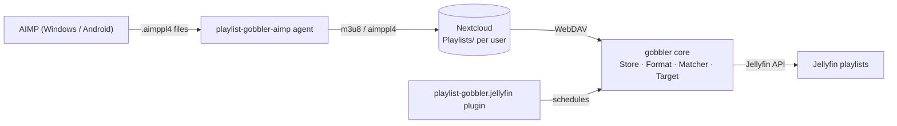

# gobbler

**Edit playlists where you like them. Play them everywhere.**

gobbler is a small, portable playlist engine. It reads playlists in the
formats real players write (AIMP's `.aimppl4` first, then `.m3u8`, `.pls`,
`.xspf`, ...), keeps them in one central place (a Nextcloud folder, a local
directory, later SMB), matches every track to your media server's library,
and pushes the result to Jellyfin (Subsonic later).

The itch it scratches: AIMP is a great playlist editor, Jellyfin is a great
server, and nothing syncs the two. AIMP's Subsonic plugin can *play*
Jellyfin playlists but not edit them, and Jellyfin's own `.m3u` imports are
read-only folder playlists.

> **Status: early.** Format adapters (`aimppl4` read, `m3u`/`m3u8`
> read+write), the matcher, the local store, the CLI and the AIMP folder agent
> work and are tested. WebDAV/Nextcloud, the Jellyfin target and `gobbler
> sync` are next. See [docs/DESIGN.md](docs/DESIGN.md#roadmap).

## Architecture in one picture



More in [docs/ARCHITECTURE.md](docs/ARCHITECTURE.md),
[docs/FLOWS.md](docs/FLOWS.md) and [docs/DATA-MODEL.md](docs/DATA-MODEL.md).

## Pieces

| Component | Where | Language | License |
|---|---|---|---|
| **gobbler** core library + CLI | this repo (`pkg/`, `cmd/gobbler`) | Go | MIT |
| **playlist-gobbler-aimp** folder agent | this repo (`cmd/playlist-gobbler-aimp`, `internal/agent`) | Go | MIT |
| Android binding (future Android agent) | this repo (`mobile/`, gomobile AAR) | Go | MIT |
| **playlist-gobbler.nextcloud** app | this repo (`playlist-gobbler.nextcloud/`) | PHP / JS | MIT |
| **playlist-gobbler.jellyfin** plugin | [sys7mfaul7/playlist-gobbler.jellyfin](https://github.com/sys7mfaul7/playlist-gobbler.jellyfin) | C# | GPL-3.0 (links Jellyfin libraries) |

## Platforms

First-class: **Windows** and **Linux** on amd64 and arm64, plus
**android/arm64** (static CLI build and a gomobile AAR). macOS and FreeBSD
builds are best-effort. Every binary is a single static, cgo-free executable.

## Quick start

```sh
go install github.com/sys7mfaul7/gobbler/cmd/gobbler@latest

gobbler formats
gobbler convert --to m3u8 "Road Trip.aimppl4" > "Road Trip.m3u8"

# Unix-style pipeline: read -> match -> (report)
gobbler read "Road Trip.aimppl4" \
  | gobbler match --library library.json --map 'M:\Music=/data/music' > report.json

# Mirror AIMP's playlist folder into a Nextcloud-synced folder
playlist-gobbler-aimp --src "%APPDATA%\AIMP\PLS" --dst "C:\Users\me\Nextcloud\Playlists"
```

## Building

```sh
make help          # list targets
make all           # vet, test, cross-compile first-class platforms, Nextcloud app tests
make mobile-aar    # Android AAR (needs Android SDK/NDK, see scripts/setup-android.sh)
make jellyfin      # builds ../playlist-gobbler.jellyfin (needs .NET 10)
```

Toolchain setup scripts live in [`scripts/`](scripts/).

## Security

AIMP Subsonic playlist entries are stream URLs containing auth tokens
(`t=`, `s=`, `p=`). gobbler never logs them: everything printed goes through
`pkg/redact`. Secrets (Jellyfin API keys, Nextcloud app passwords) come from
environment variables or a config file outside the repo, never from flags in
shell history and never from this repository.

## License

MIT, see [LICENSE](LICENSE). The Jellyfin plugin lives in its own GPL-3.0
repository because it links Jellyfin's GPL libraries.
