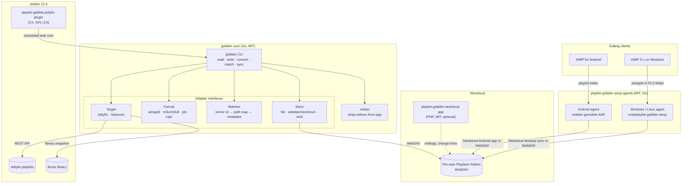
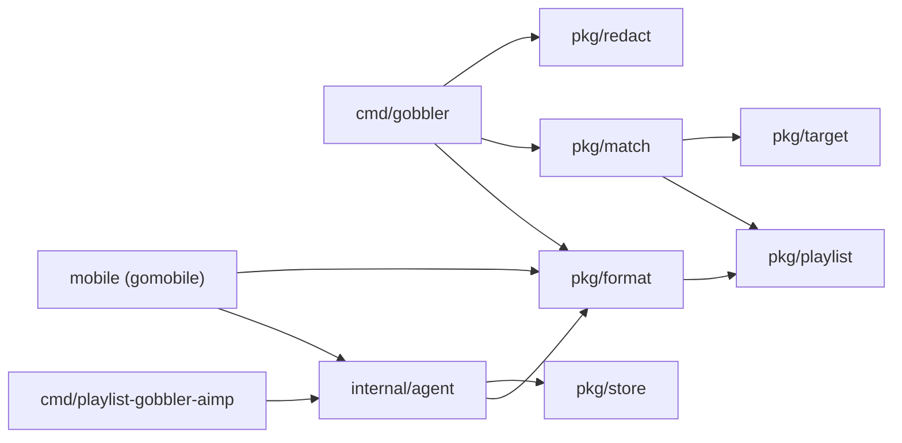

# Architecture

gobbler is one portable engine with small adapters around it, plus thin
satellites that adapt it to specific apps. Everything that can be written once
lives in the Go core; satellites stay as small as their host platform allows.

## Component diagram

## Packages

| Package | Responsibility |
|---|---|
| `pkg/playlist` | Format-neutral `Playlist` / `Track` model |
| `pkg/format` | Format adapters + registry (by name or extension), text decoding |
| `pkg/store` | Store interface + registry by URI scheme; local folder store |
| `pkg/target` | Target interface (media server) |
| `pkg/match` | Matching strategies and path-map table |
| `pkg/redact` | Credential scrubbing for anything logged |
| `internal/agent` | Polling folder mirror used by the AIMP agent and Android binding |
| `mobile` | gomobile-friendly facade (`Convert`, `SyncFolder`) |
| `cmd/gobbler` | CLI |
| `cmd/playlist-gobbler-aimp` | AIMP folder agent |
| `playlist-gobbler.nextcloud/` | Nextcloud app skeleton |

## Repositories and licenses

| Repo | Contents | License |
|---|---|---|
| `sys7mfaul7/gobbler` | core, CLI, AIMP agent, Android binding, Nextcloud app skeleton, docs | MIT |
| `sys7mfaul7/playlist-gobbler.jellyfin` | Jellyfin plugin | GPL-3.0, because it links Jellyfin's GPL libraries (same as the official plugin template) |

The Jellyfin plugin calls `gobbler` as a separate program, so the MIT core
never links GPL code.

## Platforms

| Tier | Platforms | CI |
|---|---|---|
| First-class | windows/amd64, windows/arm64, linux/amd64, linux/arm64 | test + build |
| Mobile | android/arm64 (static CLI + gomobile AAR) | build |
| Best-effort | darwin/amd64, darwin/arm64, freebsd/amd64 | build, non-blocking |
