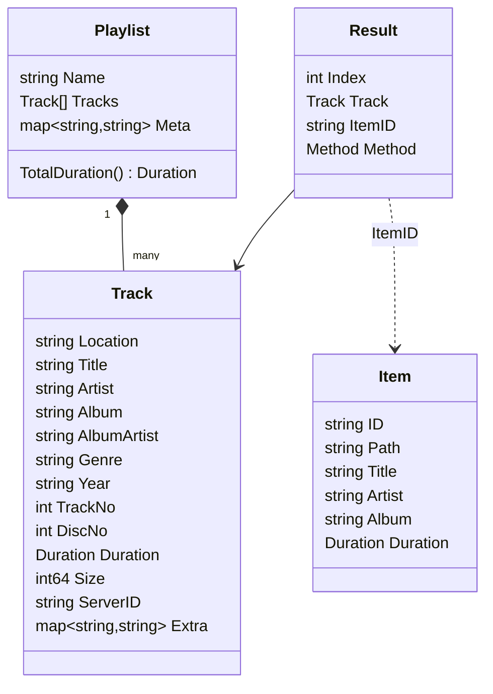
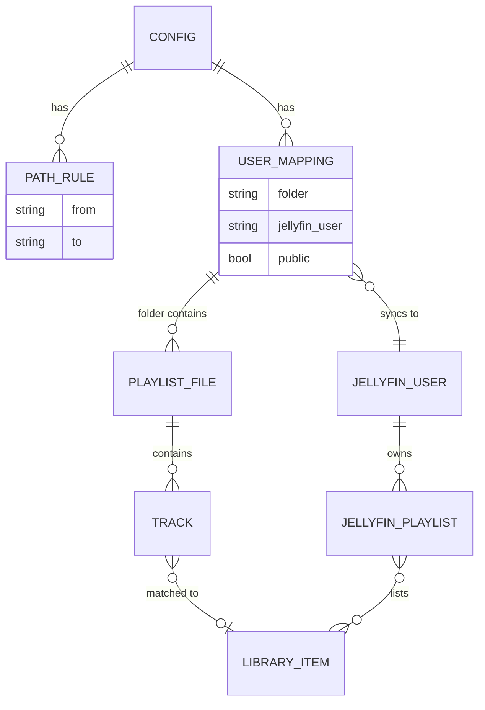

# Data model

## Playlist and track

The core converts every format into one neutral model (`pkg/playlist`). It is
also the JSON that flows between CLI commands.



* `Location` is kept exactly as the source wrote it (Windows path, UNC path,
  POSIX path or stream URL). It may contain credentials, so it is redacted in
  every report.
* `Meta` keeps format-specific playlist fields, for example
  `summary.ID` and `settings.Flags` from aimppl4.
* `Extra` keeps format-specific track fields (composer, bitrate, bpm, ...).
* `Duration` is nanoseconds in JSON (Go `time.Duration`).

Example JSON (`gobbler read Road.aimppl4`):

```json
{
  "name": "Road Trip",
  "tracks": [
    {
      "location": "M:\\Music\\Example Artist\\First Album\\01 Opening.flac",
      "title": "Opening",
      "artist": "Example Artist",
      "album": "First Album",
      "track_no": 1,
      "disc_no": 1,
      "duration": 245123000000,
      "size": 31415926,
      "extra": {"bitrate": "1011", "channels": "2", "samplerate": "44100"}
    }
  ],
  "meta": {"summary.Name": "Road Trip", "settings.Flags": "2049"}
}
```

## Match report

`gobbler match` prints:

```json
{
  "name": "Road Trip",
  "results": [
    {"index": 0, "track": {"location": "..."}, "item_id": "a1b2", "method": "path"},
    {"index": 1, "track": {"location": "..."}, "method": "unmatched"}
  ]
}
```

`method` is one of `server-id`, `path`, `metadata`, `unmatched`.

## Path-map configuration

Rules rewrite a client path prefix to the server's path. Longest `from` wins,
comparison is case-insensitive, and `\` and `/` are treated the same.

Today (flags or env):

```sh
gobbler match --library lib.json \
  --map 'M:\Music=/data/music' \
  --map '\\fileserver\private\Music=/data/scott/music'
GOBBLER_MAP='M:\Music=/data/music;N:\Music=/data/shared/music'
```

Planned config file (`$GOBBLER_CONFIG`, mode 0600, never committed):

```toml
[store]
uri = "nextcloud:/Playlists"
webdav_url = "https://cloud.example.lan/remote.php/dav/files"
# password comes from GOBBLER_WEBDAV_PASSWORD (a Nextcloud app password)

[target]
uri = "jellyfin://jellyfin.example.lan:8096"
# api key comes from GOBBLER_JELLYFIN_API_KEY

[match]
duration_tolerance = "2s"

[[path_map]]
from = 'M:\Music'
to = "/data/music"

[[path_map]]
from = 'C:\Users\me\Nextcloud\Music'
to = "/data/music"

[[users]]
folder = "shawn/Playlists"
jellyfin_user = "shawn"

[[users]]
folder = "scott/Playlists"
jellyfin_user = "scott"

[[users]]
folder = "Shared/Playlists"
jellyfin_user = "shawn"
public = true
```


