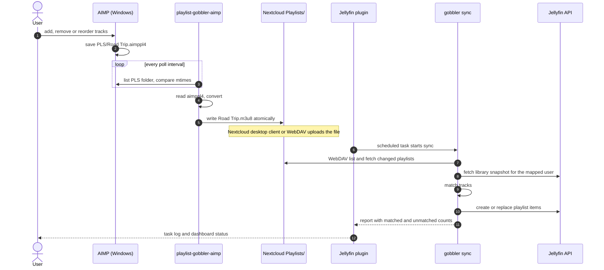
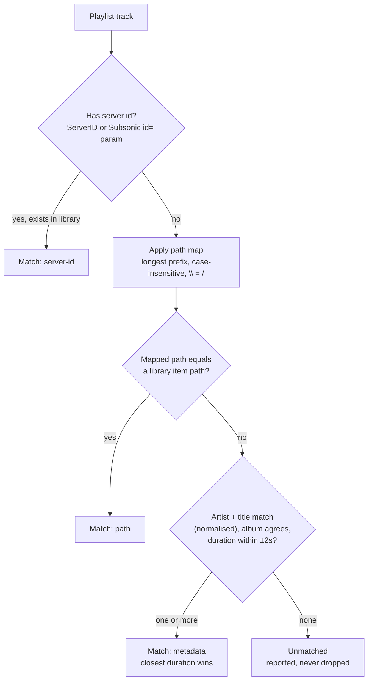
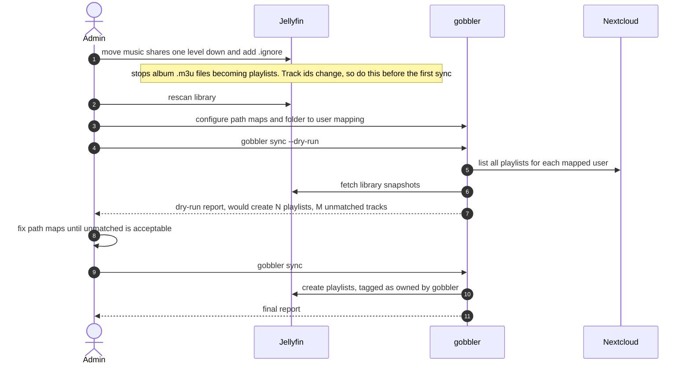
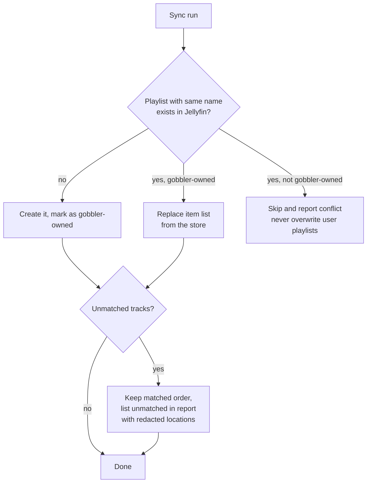
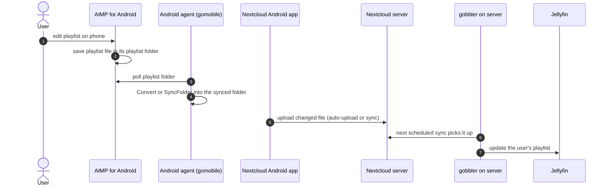

# Flows

## 1. Edit in AIMP → Jellyfin playlist (target v0.2/v0.3 flow)

## 2. Track matching pipeline

## 3. First-run import

## 4. Conflicts and unmatched tracks

In two-way mode (planned), gobbler keeps the last-synced snapshot of each
playlist and does a three-way merge of item lists; changes on both sides to the
same position are reported as conflicts instead of guessed.

## 5. Android: AIMP for Android + Nextcloud

Assumption to verify: AIMP for Android exposes its playlists as files in a
folder the agent can read. If it does not, the Android agent falls back to
importing exported `.m3u8` files.
